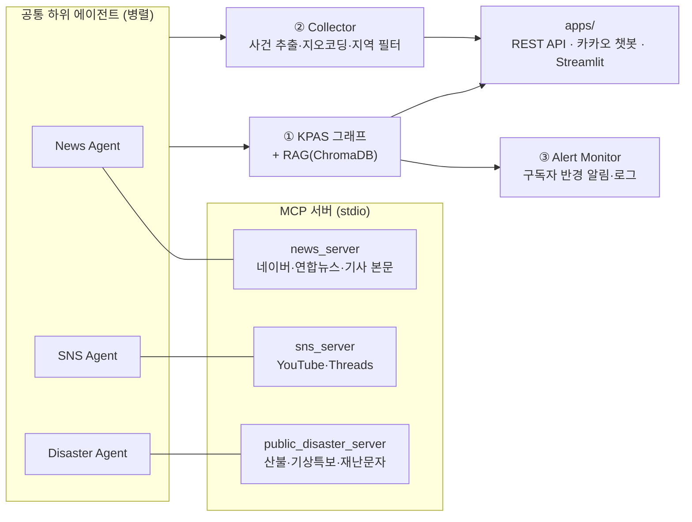

# Disaster Response Agent 🚨

뉴스 · SNS · 공공 재난데이터를 **MCP 도구 기반 멀티 에이전트**로 동시에 수집·분석해서,
재난 대응에 필요한 결과물을 만들어 주는 LangGraph 프로젝트입니다.

| 목적 | 폴더 | 결과물 |
|---|---|---|
| ① **KPAS 재난문자 초안 생성** | `disaster_agent/kpas/` | 재난문자 초안 + 작성 근거 (RAG로 대응 매뉴얼 참고) |
| ② **지역 재난 정보 수집** | `disaster_agent/collector/` | 지역별 수집 보고서 + 사건 목록(좌표 포함) JSON |
| ③ **위치 기반 재난 알림 모니터링** | `disaster_agent/alert_monitor/` | 반경 내 구독자 맞춤 알림, 날짜별 재난 로그, RAG 팀 전달용 JSON |

세 기능 모두 같은 하위 에이전트(뉴스 / SNS / 공공데이터)와 MCP 서버를 공유합니다.

## 구조



```
disaster-response-agent/
├── disaster_agent/
│   ├── config.py            # 환경변수 · 경로 설정
│   ├── llm.py               # ChatOpenAI 생성
│   ├── state.py             # LangGraph 상태
│   ├── mcp_client.py        # MCP 서버 연결
│   ├── geo.py               # 카카오 지오코딩 · 거리 계산
│   ├── agents/              # 공통 하위 에이전트 (뉴스 / SNS / 공공데이터) + 병렬 실행
│   ├── rag/                 # 재난 매뉴얼 벡터 DB (ChromaDB)
│   ├── mcp_servers/         # MCP 도구 서버 (stdio)
│   ├── kpas/                # ① KPAS 재난문자 초안 생성
│   ├── collector/           # ② 지역 재난 정보 수집
│   ├── alert_monitor/       # ③ 위치 기반 알림 모니터링
│   └── apps/                # REST API · 카카오 챗봇 · Streamlit · GPS 수집 페이지
├── data/rag_documents/      # RAG 지식 베이스 (화재·산불 대응 요령, 화재 사례)
├── examples/                # 출력 예시 JSON
├── tests/                   # API 키 없이 실행되는 테스트
└── outputs/                 # 실행 결과 저장 위치 (git 제외)
```

## 설치

Python 3.10 이상 (3.11에서 테스트)

```bash
python3.11 -m venv .venv
source .venv/bin/activate
pip install -r requirements.txt
cp .env.example .env   # 그다음 .env 에 API 키 입력
```

| 키 | 용도 | 없으면 |
|---|---|---|
| `OPENAI_API_KEY` | 모든 에이전트 (필수) | 실행 불가 |
| `NAVER_CLIENT_ID` / `SECRET` | 네이버 뉴스 검색 | 뉴스 일부 누락 |
| `YONHAP_NEWS_API_KEY`, `FOREST_FIRES_API_KEY`, `KMA_WEATHER_API_KEY`, `DISASTER_MESSAGE_API_KEY` | [재난안전데이터공유플랫폼](https://www.safetydata.go.kr) | 해당 데이터 누락 |
| `YOUTUBE_API_KEY`, `THREADS_ACCESS_TOKEN` | SNS 수집 | SNS 보고서 누락 |
| `KAKAO_REST_API_KEY` | 지명 → 좌표 변환 | 주요 도시 좌표로 대체 |

RAG 벡터 DB(`data/chroma_db/`)는 처음 필요할 때 `data/rag_documents/`로부터 자동 생성됩니다.
문서를 추가·수정했다면 `python -m disaster_agent.rag.build` 로 다시 생성하세요.

## 실행

모든 명령은 저장소 루트에서 실행합니다.

### ① KPAS 재난문자 초안

```bash
python -m disaster_agent.kpas
```

지역과 기준 시점(`2025년 2월 21일 14시 10분` 형식, 비우면 현재)을 입력하면
`KPAS 재난 문자 초안`과 `작성 근거`를 출력합니다.

### ② 재난 정보 수집

```bash
python -m disaster_agent.collector                         # 대화형: 지역 입력 → JSON 저장
python -m disaster_agent.collector.scheduler --once        # 1회 수집 (기본 범위: 대한민국)
python -m disaster_agent.collector.scheduler --interval-seconds 600 --scope 서울
```

결과: `outputs/collector/snapshots/collection_<지역>_<시각>.json` ([예시](examples/collector_snapshot.json))

### ③ 위치 기반 재난 알림 모니터링

```bash
python -m disaster_agent.alert_monitor.subscribers --seed-users 250 --seed 42   # mock 구독자 생성
python -m disaster_agent.alert_monitor --once
python -m disaster_agent.alert_monitor --interval-seconds 600 --cooldown-minutes 60
```

| 결과 | 위치 |
|---|---|
| 구독자 목록 | `outputs/alert_monitor/subscribers.json` |
| 중복 알림 방지 이력 | `outputs/alert_monitor/alert_history.json` |
| 날짜별 재난 로그 | `outputs/alert_monitor/disaster_logs/disaster_log_<날짜>.json` |
| RAG 팀 전달용 | `outputs/alert_monitor/rag_export/rag_incidents_<시각>.json` ([예시](examples/alert_monitor_rag_export.json)) |

현재 알림은 콘솔 출력(`notify()`)이며, 실제 발송 채널은 `alert_monitor/monitor.py`의 `notify()`에 연결하면 됩니다.

### 서버 / 웹

```bash
# REST API  →  http://localhost:8000/docs
uvicorn disaster_agent.apps.api:app --port 8000

# 카카오 i 오픈빌더 스킬 서버 (스킬 URL: /skill/chat, 콜백 사용 설정 필요)
KAKAO_MODE=collect uvicorn disaster_agent.apps.kakao:app --port 8000   # 또는 KAKAO_MODE=kpas

# Streamlit 웹 데모
python -m streamlit run disaster_agent/apps/streamlit_app.py

# 브라우저 GPS 수집 페이지 (MCP GPS 서버용 outputs/location.json 저장)
uvicorn disaster_agent.apps.location_collector:app --port 8001
```

| REST API | 설명 |
|---|---|
| `GET /health` | 상태 확인 |
| `POST /collect/run` | `{"location": "신촌"}` → 수집 + 사건 목록 JSON |
| `POST /monitor/run-once` | 주기 수집기 1회 실행 후 저장 경로 반환 |
| `POST /kpas/draft` | `{"location": "강남역"}` → 재난문자 초안 |

`.env`에 `EXTERNAL_API_KEY`를 설정하면 모든 POST 요청에 `x-api-key` 헤더가 필요합니다.

## 테스트

```bash
pip install -r requirements-dev.txt
python -m pytest
```

API 키나 네트워크 없이 실행됩니다. (사건 추출 규칙, 지역 필터, 알림 규칙, 구독자 저장, 키 마스킹, 서버 헬스체크, Streamlit 렌더링)

## 참고

- `AGENT_VERBOSE=1` 이면 하위 에이전트의 전체 실행 과정(메시지)을 출력합니다.
- MCP 서버의 API 오류 메시지는 `serviceKey`, `access_token` 값을 가린 뒤 에이전트에 전달합니다.
- `gps_server.py`는 기본 비활성화 상태입니다. 쓰려면 `mcp_client.py`에 등록하세요.
